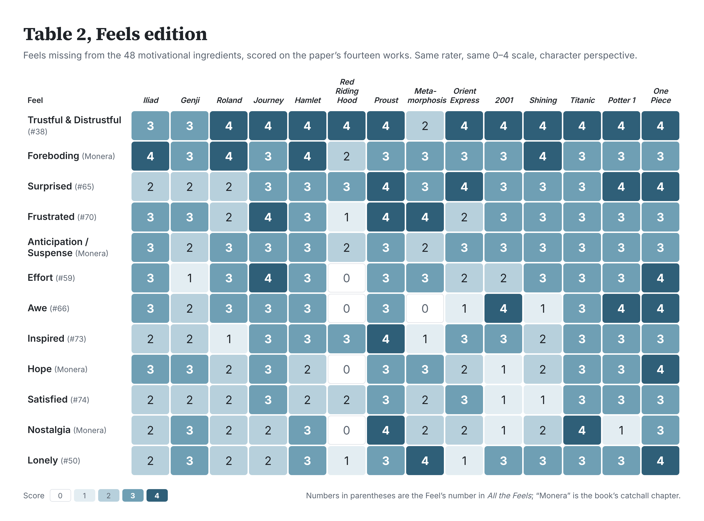

# The Recipe for Hamlet: the files

Everything behind the Living Fossils post *The Recipe for Hamlet*, which compares the 48 motivational ingredients of Dubourg, Thouzeau et al. (2026), "Carving Stories at Their Natural Joints" (*Psychological Review*), with the 74 Feels of *All the Feels* (Rob Kurzban, 2026).

The question the post asks: if you score the paper's fourteen works with the 74 Feels, using the paper's own method, do any Feels show up that the 48 ingredients lack?



## What is here

| Folder | What it holds |
|---|---|
| [`SKILL.md`](SKILL.md) | The first instruction file: how Claude scores a story on the 48 ingredients. The definitions are the authors' own, copied from the prompt they published. |
| [`feels-skill/SKILL.md`](feels-skill/SKILL.md) | The second instruction file: how Claude scores a story on the 74 Feels, plus eight rows from the book's Monera chapter. Same scale, same rules. |
| [`calibration/`](calibration/) | The check that the rater can reproduce the authors' judgments. Fourteen works scored on the 48 ingredients, compared with the authors' verified Table 2. Two runs: `run1/` (before the scale fix) and the final run. [`comparison-report.md`](calibration/comparison-report.md) has the agreement figures; [`comparison.csv`](calibration/comparison.csv) lists every cell, both scores, and the rater's reason. |
| [`feels/`](feels/) | The fourteen works scored on the 74 Feels and the eight extra rows, twice: [`character/`](feels/character/) (what the characters feel) and [`audience/`](feels/audience/) (what the story is built to make a first-time reader feel). Every score has a one-sentence reason. [`feels-annotations.csv`](feels/feels-annotations.csv) is the whole thing as one spreadsheet. |
| [`crosswalk/`](crosswalk/) | The comparison. [`crosswalk.csv`](crosswalk/crosswalk.csv) maps each ingredient to its nearest Feel or Feels. [`crosswalk.py`](crosswalk/crosswalk.py) applies the rules and writes [`cells.csv`](crosswalk/cells.csv), [`pairs.csv`](crosswalk/pairs.csv), and [`report.md`](crosswalk/report.md). |
| [`references/`](references/) | The list of the fourteen works and the authors' published prompt. |
| [`scripts/`](scripts/) | The calibration scripts. |
| [`images/`](images/) | The two tables from the post as images. |

## The method, in short

1. **Two instruction files, one rater.** The authors' Table 2 scores were made by a language model reading each work against their 48 definitions, then checked by the authors. Here, Claude (claude-fable-5-1) does the same job twice: once with their 48 definitions, once with the 74 Feels. Each cell gets a score from 0 (absent) to 4 (runs through the whole work) and a one-sentence reason naming the story elements that earned it.
2. **Calibrate first.** Before scoring the Feels, the rater scored the authors' fourteen works on their 48 ingredients in a session that had not seen Table 2, and a script compared the result with the authors' verified scores. First run: rank correlation 0.68, every score about three quarters of a point low, because the instructions said a 4 "should be rare." The authors do not use 4 that way. Second run, with that sentence removed and their exact definitions pasted in: weighted kappa 0.70, rank correlation 0.71, exact agreement 43%, within one point 86.5%, no overall bias. The figures are in [`calibration/comparison-report.md`](calibration/comparison-report.md).
3. **Then the Feels.** The rater scored the same fourteen works on the 74 Feels and eight Monera rows, character pass first for all fourteen, then audience pass for all fourteen. 1,148 cells per pass.
4. **Then the crosswalk.** A table maps each ingredient to its nearest Feel or Feels. A script counts, for every work, where the two frameworks agree, what each adds that the other lacks, and which Feels earn a row in the table above.

## The rules

- **Addition rule.** A Feel cell "adds something" when it scores 3 or 4 and every ingredient it could be mistaken for scores 0 or 1 in both columns, the authors' and the rater's. The rule is deliberately strict: it is why Lonely in *The Shining* counts (the authors' Affiliation is 0) and Lonely in *The Metamorphosis* does not (they gave Affiliation 4).
- **Mirror-image rule.** An ingredient cell scores 3 or 4 in both columns and every Feel near it scores 0 or 1. It fires eleven times, for exactly the four ingredients that are activities rather than feelings: Mental time travel, Resource accumulation, Resource foraging, Forgiveness.
- **Table rows.** A Feel with no counterpart in the ingredient list that scores 3 or 4 in at least five works.

## The table, as data

Character perspective, scores 0 to 4. These are the cells of the image above, read from [`crosswalk/cells.csv`](crosswalk/cells.csv).

| Feel | Iliad | Genji | Roland | Journey | Hamlet | Red Riding Hood | Proust | Metamorphosis | Orient Express | 2001 | Shining | Titanic | Potter 1 | One Piece |
|---|---|---|---|---|---|---|---|---|---|---|---|---|---|---|
| Trustful & Distrustful (#38) | 3 | 3 | 4 | 4 | 4 | 4 | 4 | 2 | 4 | 4 | 4 | 4 | 4 | 4 |
| Foreboding (Monera) | 4 | 3 | 4 | 3 | 4 | 2 | 3 | 3 | 3 | 3 | 4 | 3 | 3 | 3 |
| Surprised (#65) | 2 | 2 | 2 | 3 | 3 | 3 | 4 | 3 | 4 | 3 | 3 | 3 | 4 | 4 |
| Frustrated (#70) | 3 | 3 | 2 | 4 | 3 | 1 | 4 | 4 | 2 | 3 | 3 | 3 | 3 | 3 |
| Anticipation / Suspense (Monera) | 3 | 2 | 3 | 3 | 3 | 2 | 3 | 2 | 3 | 3 | 3 | 3 | 3 | 3 |
| Effort (#59) | 3 | 1 | 3 | 4 | 3 | 0 | 3 | 3 | 2 | 2 | 3 | 3 | 3 | 4 |
| Awe (#66) | 3 | 2 | 3 | 3 | 3 | 0 | 3 | 0 | 1 | 4 | 1 | 3 | 4 | 4 |
| Inspired (#73) | 2 | 2 | 1 | 3 | 3 | 3 | 4 | 1 | 3 | 3 | 2 | 3 | 3 | 3 |
| Hope (Monera) | 3 | 3 | 2 | 3 | 2 | 0 | 3 | 3 | 2 | 1 | 2 | 3 | 3 | 4 |
| Satisfied (#74) | 2 | 2 | 2 | 3 | 2 | 2 | 3 | 2 | 3 | 1 | 1 | 3 | 3 | 3 |
| Nostalgia (Monera) | 2 | 3 | 2 | 2 | 3 | 0 | 4 | 2 | 2 | 1 | 2 | 4 | 1 | 3 |
| Lonely (#50) | 2 | 3 | 2 | 2 | 3 | 1 | 3 | 4 | 1 | 3 | 3 | 3 | 3 | 4 |

Numbers in parentheses are the Feel's number in *All the Feels*. "Monera" rows are from the book's catchall chapter.

## Run it yourself

Python 3, no packages needed. From the repository root:

```
python3 scripts/validate_annotations.py calibration/*.json
python3 scripts/compare_calibration.py
python3 feels/scripts/validate_feels.py feels/character/*.json feels/audience/*.json
python3 crosswalk/crosswalk.py
```

To score a story of your own, give either instruction file to Claude and name a title. The Feels are listed on the book's taxonomy page at [allthefeelsbook.com](https://allthefeelsbook.com).

## Limits

One rater, one run per work, no repeats. The ratings rest on the rater's unverified knowledge of the works. The same model rated both sides, which buys consistency and costs independence. A demonstration, not data. For a comparison meant for publication, rate each work several times and report the median.

## Credits

The 48 ingredient definitions, the fourteen works, and the verified Table 2 scores are the work of Edgar Dubourg, Valentin Thouzeau, Nicolas Baumard, and their co-authors; the paper is at *Psychological Review* and the site at [motivational-ingredients.com](https://motivational-ingredients.com). They published the prompt their site uses, which is what made this comparison possible.

The 74 Feels are from *All the Feels* by Rob Kurzban (Re:Writers, 2026). The ratings, scripts, and crosswalk were made with Claude (Anthropic, claude-fable-5-1) in October 2026.

## License

The ratings, crosswalk, and scripts in this repository are released under [CC BY 4.0](https://creativecommons.org/licenses/by/4.0/). The ingredient definitions in `SKILL.md` and `references/site-system-prompt.txt` are quoted from the authors' published prompt and remain theirs.
